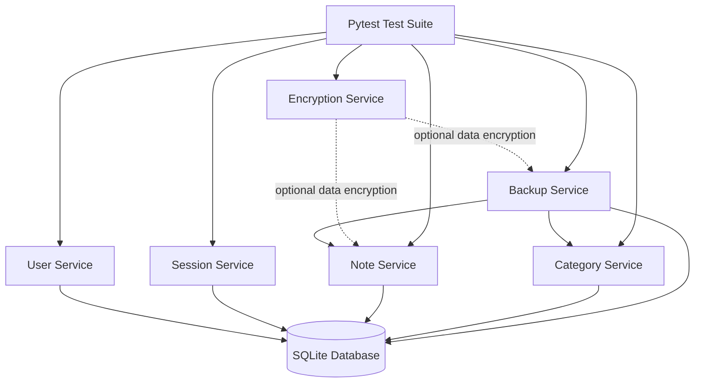

# Software Engineering Lab

[](https://www.python.org/)
[](https://flask.palletsprojects.com/)
[](https://www.sqlite.org/)
[](https://docs.pytest.org/)
[](https://opensource.org/licenses/MIT)

This repository contains the coursework, technical documentation, UML models, and software implementation for the **Software Engineering Lab** (Department of Computer Engineering, Advanced College of Engineering and Management, Institute of Engineering, Tribhuvan University).

The lab project centers around **Guptrix**, a lightweight, encrypted note management system and canvas workspace designed to provide secure, structured, and fast knowledge management.

---

## Academic Information

- **Institution**: Advanced College of Engineering and Management (ACEM)
- **Affiliation**: Institute of Engineering (IOE), Tribhuvan University
- **Program**: Bachelor in Computer Engineering (BCT)
- **Subject**: Software Engineering Lab
- **Student**: Ritik Thakur (`ACE080BCT056`)
- **Instructor**: Rahul Kumar Mandal

---

## Repository Structure

```text
software_lab/
├── .github/
│   └── workflows/
│       └── python-tests.yml           # Automated CI testing pipeline
├── docs/
│   ├── reports/
│   │   ├── SE_Lab1_Report.pdf         # Lab 1: Problem statement, requirements & analysis
│   │   ├── SE_Lab2_Report.docx        # Lab 2: Software specifications & design document
│   │   └── SE_Lab_Combined_Report.pdf # Cumulative report (Lab 1 through Lab 2)
│   └── diagrams/
│       ├── Guptrix_StarUML_Model.mdj  # StarUML project model file
│       ├── Use_Case_Diagrams.pdf      # Exported system use case diagrams
│       └── Lab2_UML_Diagrams.pdf      # Exported use case & class diagrams
├── gupt_site/                         # Web application implementation
│   ├── app.py                         # Flask REST API and web server
│   ├── database.py                    # SQLite schema initialization and connection manager
│   ├── user.py                        # User authentication and profile service
│   ├── session.py                     # Session validation and management
│   ├── note.py                        # Note CRUD and search service
│   ├── category.py                    # Category mapping and organization
│   ├── backup.py                      # JSON import/export backup engine
│   ├── encryptionService.py           # String encryption helper
│   ├── requirements.txt               # Python package dependencies
│   ├── tests/                         # Unit, integration, and system test suite
│   │   ├── test_*_unit.py             # Service unit tests
│   │   ├── test_integration_flow.py   # Multi-service integration tests
│   │   └── test_system_flow.py        # End-to-end API system tests
│   └── www/                           # Glassmorphic frontend assets (HTML, CSS, JS)
├── .gitignore                         # Git exclusion rules
└── README.md                          # Repository documentation
```

---

## Lab Assignments & Deliverables

### Lab 1: System Analysis & Requirements Engineering
- **File**: [`docs/reports/SE_Lab1_Report.pdf`](docs/reports/SE_Lab1_Report.pdf)
- **Overview**: Establishes the problem definition, existing system limitations, proposed solution, functional and non-functional requirements, and initial scope for the Guptrix platform.

### Lab 2: Object-Oriented Modeling & UML Design
- **Reports**: [`docs/reports/SE_Lab2_Report.docx`](docs/reports/SE_Lab2_Report.docx), [`docs/reports/SE_Lab_Combined_Report.pdf`](docs/reports/SE_Lab_Combined_Report.pdf)
- **UML Diagrams**:
  - **StarUML Model**: [`docs/diagrams/Guptrix_StarUML_Model.mdj`](docs/diagrams/Guptrix_StarUML_Model.mdj)
  - **Use Case Diagrams**: [`docs/diagrams/Use_Case_Diagrams.pdf`](docs/diagrams/Use_Case_Diagrams.pdf)
  - **Class & Use Case Sheets**: [`docs/diagrams/Lab2_UML_Diagrams.pdf`](docs/diagrams/Lab2_UML_Diagrams.pdf)
- **Key Concepts Covered**:
  - Actor definitions and system boundaries.
  - `<<include>>` and `<<extend>>` use case relationships (e.g., password protection, encryption, search, backup).
  - Class diagrams detailing attributes, visibility, operations, multiplicity, and associations across services (`User`, `Session`, `Note`, `Category`, `Backup`, `Encryption`).

---

## Project Implementation (`gupt_site`)

The implementation model is a lightweight Python/Flask web application following a modular service-oriented architecture:



### Key Modules
| Module | Responsibility |
| :--- | :--- |
| `user.py` | User registration, password hashing, credential verification |
| `session.py` | Session token generation, activity tracking, expiry validation |
| `note.py` | Encrypted note persistence, editing, deletion, and keyword search |
| `category.py` | Tagging and hierarchical note classification |
| `backup.py` | JSON export/import for disaster recovery and offline migration |
| `encryptionService.py` | String-level reversible encryption helpers |
| `database.py` | Foreign-key enforced SQLite schema and query dispatchers |
| `app.py` | REST API routes (`/api/*`) and static web server |

---

## Quickstart Guide

### Prerequisites
- Python 3.10 or higher
- Git

### 1. Clone the Repository
```bash
git clone https://github.com/ritikthakur22/software_lab.git
cd software_lab
```

### 2. Set Up Virtual Environment
```bash
cd gupt_site
python3 -m venv venv

# On Linux / macOS:
source venv/bin/activate

# On Windows:
venv\Scripts\activate
```

### 3. Install Dependencies
```bash
pip install -r requirements.txt
```

### 4. Run the Application
```bash
python app.py
```
Open [http://localhost:8000](http://localhost:8000) in your web browser.

---

## Running the Automated Test Suite

All tests can be executed directly using `pytest` from inside the `gupt_site/` directory:

```bash
# Run unit tests
python -m pytest -q tests/test_*_unit.py

# Run integration tests
python -m pytest -q tests/test_integration_flow.py

# Run system end-to-end tests
python -m pytest -q tests/test_system_flow.py

# Run all tests with summary
python -m pytest -v tests/
```

Continuous integration runs automatically on every push or pull request via GitHub Actions ([`.github/workflows/python-tests.yml`](.github/workflows/python-tests.yml)).

---

## License

This project is licensed under the [MIT License](LICENSE).
