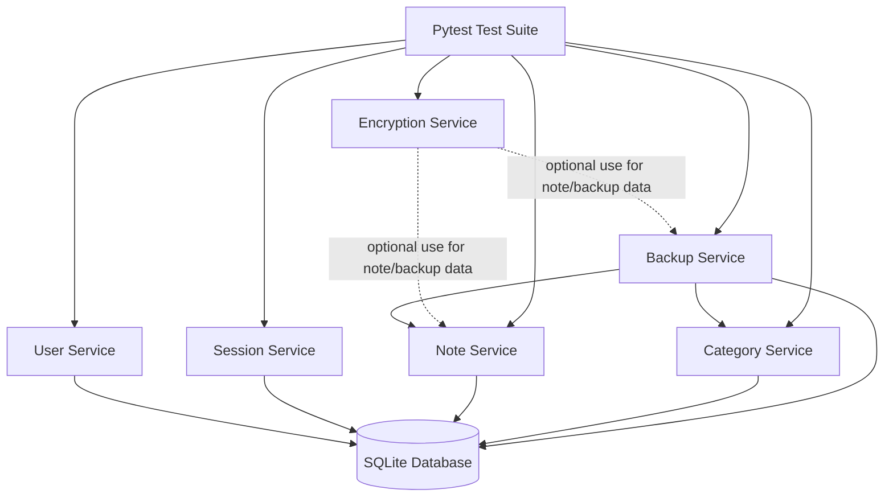

# Guptrix Secure Notes

A lightweight, zero-knowledge, end-to-end encrypted notes application featuring a sleek, modern UI. Built with a Python/Flask backend and a premium glassmorphic frontend.

## Features
- **Modern Glassmorphic UI**: Premium dark mode, animated gradient backgrounds, glassmorphic panels, and neon glow accents.
- **Secure Architecture**: SQLite-backed services for user registration, session management, and encrypted notes.
- **Note Management**: Create, edit, delete, and categorize notes securely.
- **API-First**: Frontend communicates entirely via minimal REST APIs (`/api/*`).
- **Comprehensive Testing**: Full test suite covering unit tests, integration workflows, and system end-to-end flows using PyTest.

## Project Structure

- `user.py`: User registration, login, and profile updates
- `session.py`: Session creation, validation, and termination
- `note.py`: Note CRUD operations and keyword search
- `category.py`: Category creation and note-category mapping
- `backup.py`: Export and import notes as JSON
- `encryptionService.py`: Reversible string encryption helper
- `database.py`: SQLite schema and connection helpers
- `app.py`: Flask application serving REST APIs and static assets
- `www/`: Modern glassmorphic frontend static files (HTML, CSS, JS)
- `tests/`: Unit, integration, and system tests

## Requirements

- Python 3.10+
- Flask >= 2.0
- pytest >= 7.0
- gunicorn (for production)

## Local Setup & Development

1. Navigate to the application directory:
   ```bash
   cd gupt_site
   ```

2. Create and activate a virtual environment:
   ```bash
   python3 -m venv venv
   source venv/bin/activate   # On Windows: venv\Scripts\activate
   ```

3. Install dependencies:
   ```bash
   pip install -r requirements.txt
   ```

4. Run the development server:
   ```bash
   python3 app.py
   ```

5. Open your browser at `http://localhost:8000`.

## Production Hosting

To host Guptrix in a production environment using Gunicorn:

```bash
gunicorn -w 4 -b 0.0.0.0:8000 app:app
```

## Running the Test Suite

Make sure your virtual environment is active and run tests from the `gupt_site/` directory:

### Unit Tests
```bash
python3 -m pytest -q tests/test_*_unit.py
```

### Integration Tests
```bash
python3 -m pytest -q tests/test_integration_flow.py
```

### System Tests
```bash
python3 -m pytest -q tests/test_system_flow.py
```

### Full Test Suite
```bash
python3 -m pytest -q tests/test_*_unit.py tests/test_integration_flow.py tests/test_system_flow.py
```

## Architecture Diagram


